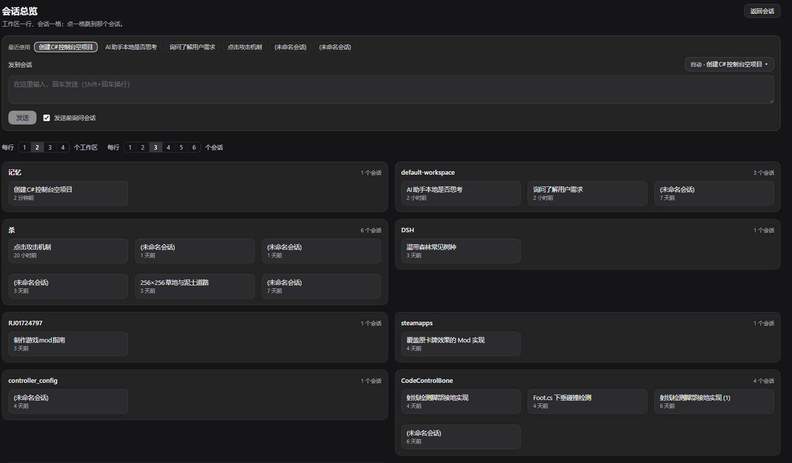

# dsh-session-overview

[](https://github.com/airplanebig/dsh-session-overview/actions/workflows/test.yml)

给 [DeepSeek Harness](https://github.com/deepseek-ai/deepseek-harness)（DSH）加一个**总窗口**：在一个页面里看遍所有工作区的会话，输入一句话，自动匹配最可能的目标会话，确认后把需求投递进去。

> 会话按工作区分开，是为了前缀缓存和上下文隔离；但“这次该去哪个会话”不该由用户记。这个插件补的就是那一层。



*深色主题下的实际界面：顶部是最近使用与投递目标，中间是输入区，下面按工作区分组成会话格子。*

## 特性

- **跨工作区总览**：工作区是面板，会话是格子，按最近活动排序，点一格跳过去。
- **自动匹配**：输入时用会话全文检索 + 标题/目录二元组匹配打分，自动把目标切到最可能的会话，并写明依据。
- **手动锁定**：`▾` 里选一次就锁定，之后输入再多也不改目标；选「自动匹配」解锁。
- **最近使用**：输入框上方一排最近 6 个会话，点一下即锁定。
- **可切换的工作区标签**（默认开）：最近使用与下拉列表里的会话采用**上下两层**显示——上排工作区、下排会话名，两行各自截断，长名字不会互相挤占。关掉后只显示单层会话名。同名工作区自动用父目录区分（`A/记忆` 与 `B/记忆`）。
- **发送前确认**（默认开）：非锁定状态下第一次回车只提示「将投递到 `<会话>`」，再回车才发，`Esc` 取消。
- **主题自适应**：全部走 DSH 设计令牌，深色/浅色都不需要额外配置。

## 界面

```
┌ 最近使用  [做一个 C# 控制台项目] [大肥鱼插画] [Unity 穿墙修复] ┐
│ 发到会话                                        [推荐 · 大肥鱼插画 ▾] │
│ [在这里输入，回车发送…                                         ] │
│ [确认发送]  [x] 发送前询问会话  [x] 显示工作区   按对话内容匹配 · 画了一只大肥鱼   │
│ ┌ 将投递到 大肥鱼插画 · 按对话内容匹配 ──────────────────────┐ │
│ │                              回车确认 · Esc 取消  [取消]   │ │
│ └────────────────────────────────────────────────────────────┘ │
└─────────────────────────────────────────────────────────────┘
每行 [1][2][3][4] 个工作区 · 每行 [1][2][3][4][5][6] 个会话
┌ 记忆 ─────────────── 2 个会话 ─┐  ┌ 杀 ────── 1 个 ┐
│ [会话A] [会话C] [     ]        │  │ [会话B]       │
│ [     ] [     ] [     ]        │  │               │
└────────────────────────────────┘  └───────────────┘
```

入口在侧边栏「插件」「自动化任务」下面，收起侧边栏时显示两个实心方块图标。

## 安装

### 桌面端（Electron，`desktop` profile）

CLI 拒绝 `--profile desktop`，需要手动两步：

1. 在 `~/.dsh/profiles/desktop/package.json` 的 `dependencies` 加入本地路径：

   ```json
   "dsh-session-overview": "link:D:\\path\\to\\dsh-session-overview"
   ```

   并在 `dsh.profile.bundles` 数组末尾加入 `"dsh-session-overview"`。

2. 在 `~/.dsh/profiles/desktop` 里执行一次 `pnpm install`（用 DSH 自带的 pnpm）。

**重启 DSH** 生效。目录是 `link:` 依赖（Windows 上是 junction），改代码后只需重启，不必重装。

### Web profile

```bash
dsh plugin --profile web add link:/path/to/dsh-session-overview
```

## 使用

### 路由规则

输入 ≥2 个字符后，250ms 防抖触发一次匹配：

| 层级 | 依据 | 权重 |
|---|---|---|
| 1 | 关键词逐条检索 `ctx.sessions.search(term)`，命中按词的区分度加权后合并 | 标识符 1 · 中文三元组以上 1 · 常见二元组 0 · 普通二元组 0.45，总分上限 1.6 |
| 2 | 会话标题的字符二元组重合度（取最佳从句） | 0–1 |
| 3 | 工作区目录名重合度（取最佳从句） | 0–0.5 |
| 4 | 最近活动时间 | 0–0.12，仅用于破平手 |

最高分 ≥ **0.35** 且领先第二名 ≥ **0.05** 才自动切换；否则保持原目标，不做猜测。

**为什么按区分度加权**：索引里的「实现 Move」会把「实现」拆成独立 token，如果把每个命中都算 1 分，`实现` 这种到处都是的词就会压过 `bow`、`arrow` 这种真正有指向性的词——实测就发生过，需求被投给了不相干的 Unity 会话。现在常见二元组权重为 0，标识符权重最高，且总分封顶。

**为什么先拆关键词**：会话检索是**字面短语**匹配——把整句「实现Bow类，Bow使用的arrow需要在背包中寻找」丢进去，没有任何会话包含这句话，命中必然为零。所以先抽词：

- ASCII 标识符优先（`Bow`、`arrow`、`weapon`），它们信号最强；
- 中文按二元组顺序抽（`实现`、`使用`、`背包`…）；
- 实时预览最多搜 4 个词，确认时搜 10 个（确认那一步可以多花点时间）。

同一会话被多个关键词命中会额外加分——`Bow` 和 `背包` 都命中同一个会话，比只命中一个更可信。

**标题与目录按从句打分**：在句末补一句「（可以考虑将攻速处理迁移至weapon）」这类说明，不会拉低主句的匹配度——分数取各从句里的最高值，附加说明只是多了一个候选从句。

> 宿主的内容检索默认关闭（`openAt: never`），且 FTS5 的 `unicode61` 分词把连续的中英混排视为**一个 token**，所以「背包」这类中文片段即使索引了也匹配不到。插件在检索不可用时会直接在输入区下方提示，并给下拉列表加了过滤框用于手选。

### 状态徽标

| 状态 | 显示 | 颜色 |
|---|---|---|
| 已锁定 | `已锁定 · 会话名` | `--dsw-alias-state-warn-primary`（琥珀） |
| 推荐 | `推荐 · 会话名` | `--dsw-alias-brand-primary`（品牌蓝） |
| 自动 | `自动 · 会话名` | `--dsw-alias-label-tertiary`（灰） |

### 发送前确认

开关默认开启，状态存 `localStorage` 的 `dsh-session-overview:ask`。

| 状态 | 第一次回车 | 结果 |
|---|---|---|
| 未锁定 + 开关开 | 只匹配并提示目标 | 再回车 / 点「确认发送」才投递；`Esc` 取消 |
| 已锁定 + 开关开 | 直接投递 | 手动选过，不再二次打扰 |
| 开关关 | 直接投递 | 旧行为 |

- 弹确认时会**重新检索一次**，不使用防抖缓存，避免“打完字立刻回车”匹配到上一条输入。
- 确认条存在时 `Esc` 只取消确认，不会关闭面板。
- 修改输入会自动撤掉确认条；取消后草稿保留。

### 布局

- 工作区、会话各自按最近活动排序。
- 分段控件控制每行工作区数（1–4，默认 2）与会话数（1–6，默认 3），存在 `localStorage` 的 `dsh-session-overview:layout`。

### 工作区标签

输入框下方「显示工作区」开关，默认开启，状态存 `localStorage` 的 `dsh-session-overview:workspace`。

开启时，最近使用与下拉列表里的会话改成**上下两层**：

```
记忆                    A/记忆
创建一个 C# 控制台项目    创建一个 C# 控制台项目
```

上排是工作区（灰色小字），下排是会话名。两行各自截断（各 168px + 省略号），所以长工作区名不会挤掉会话名——这正是上下分层要解决的问题。

| 情况 | 显示 |
|---|---|
| 开 + 工作区名唯一 | `记忆` / 会话名 |
| 开 + 两个工作区同名 | `A/记忆`、`B/记忆`（自动用父目录区分） |
| 开 + 会话不在工作区注册表里 | 退回该会话自己的目录名（`cwd` 末段） |
| 关 | 只显示单层会话名 |

完整名称（工作区 + 会话名）在悬浮提示里。工作区卡片内部不重复显示工作区名——卡片标题已经是它。

## 主题适配

不写死颜色，全部使用 DSH 设计令牌：

```
--dsw-alias-label-primary / secondary / tertiary / primary-foreground
--dsw-alias-border-l1 / l2
--dsw-alias-bg-layer-1 / 2
--dsw-alias-interactive-bg-active
--dsw-alias-button-primary-fill
--dsw-alias-menu-surface-fill / elevation-panel  (--dsw-menu-surface-fill)
--dsw-radius-md / lg
```

主按钮必须成对使用：

```css
background: var(--dsw-alias-button-primary-fill);
color: var(--dsw-alias-label-primary-foreground);
```

深色主题下品牌蓝偏亮，`label-primary-foreground` 会自动切成深色文字；写死 `#fff` 会白字压浅蓝。

## 工作原理

- 它是**主面板**（`main` 插槽 + `sidebar.panellist` 入口），不是浮层——所以不会挡住界面，切走即关闭。
- 投递走会话控制器自己的写路径，不是模拟点击：

  ```js
  await ctx.sessions.using(sessionId, { source: "session-overview" }, (reference) =>
    reference.binding.session.prompt([{ type: "text", text }], "queue")
  );
  ```

  `queue` 模式意味着目标会话正在跑时会排在后面，不抢占当前回合。
- 投递成功后跳到目标会话，方便立刻看反馈；失败保留草稿并显示错误。
- 匹配只决定“发到哪”，从不自动打开或修改任何会话。

## 开发

```bash
node test/selftest.cjs       # 72 项离线校验，不需要 DSH、不需要浏览器
```

自测用假的模块加载器 + 假 React + 假会话 API，把 `lib/client.js` 真正加载、注册、渲染并驱动一遍。

内部结构、API 契约与修改须知见 [AGENTS.md](AGENTS.md)。

## 兼容性

- 在 DSH 桌面版（Electron，`desktop` profile）上开发与验证。
- 依赖的客户端服务：`slots`、`sessions`、`workspaces`、`uiWorkspace`、`locale`、`layout`。
- 内容检索（`ctx.sessions.search`）依赖宿主的 `sessionQuery` 服务；不可用时自动退回标题匹配。

## 已知限制 / 路线图

- 不能新建会话，只能投递到已有会话。
- 不接上下文预处理（剪枝/检索改写）——设计已写成 [docs/PHASE4.md](docs/PHASE4.md)，**未实现**，等后来者接手。
- 匹配只使用标题、目录与全文检索；没有“最近一条用户消息”这类特征。
- 宿主没有 `sessionQuery` 时匹配准确率明显下降。

## 许可

[MIT](LICENSE)
